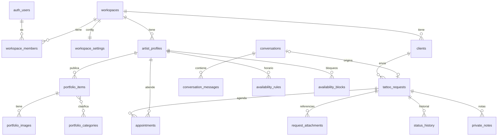

# Base de datos

> Estado: **sin tablas todavía.** El modelo se crea en la Fase 2 con migraciones en `supabase/migrations/`. Este documento es el diseño acordado en la Fase 0.

## Convenciones

- PK `id uuid default gen_random_uuid()`.
- `created_at` y `updated_at` (`timestamptz`) en todas las tablas.
- Toda tabla privada tiene `workspace_id uuid not null` y RLS activa.
- Estados como `text` + `CHECK` (más fáciles de migrar que `enum`).
- Dinero en `numeric(12,2)` + `currency`, nunca `float`.
- Fechas en `timestamptz` (UTC). Se muestran en la zona del workspace.
- Borrado lógico (`deleted_at`) en entidades de negocio. Borrado físico solo para pedidos de supresión de datos.

## Modelo (v1)



| Tabla | Claves y restricciones principales |
|---|---|
| `workspaces` | `slug` único (URL pública) |
| `workspace_members` | PK (`workspace_id`, `user_id`), `role in ('owner','artist','staff')` |
| `workspace_settings` | 1:1 con workspace; `locale`, `currency`, `timezone`, textos públicos, proceso y FAQ (`jsonb`) |
| `artist_profiles` | `workspace_id`, `user_id`, `display_name`, `bio`, `styles text[]`, `is_public` |
| `portfolio_items` | `status in ('draft','published')`, `position`; índice (`workspace_id`, `status`, `position`) |
| `portfolio_images` | `storage_path` en bucket **público** |
| `portfolio_categories` + `portfolio_item_categories` | únicas por workspace |
| `clients` | único parcial (`workspace_id`, `lower(email)`) donde `deleted_at is null` |
| `conversations` / `conversation_messages` | `public_token_hash`, `expires_at` (retención limitada) |
| `tattoo_requests` | `status in ('new','reviewing','needs_info','quoted','accepted','rejected','completed','cancelled')`, `source in ('form','assistant','manual')`, `public_token_hash` |
| `request_attachments` | bucket **privado**, URLs firmadas |
| `status_history` | solo insert |
| `private_notes` | nunca expuestas por rutas públicas |
| `availability_rules` / `availability_blocks` | horario en hora local + zona del workspace; bloqueos como `tstzrange` |
| `appointments` | `EXCLUDE USING gist (artist_id WITH =, blocked_range WITH &&) WHERE (status = 'confirmed')` |

Postergadas hasta después de la v1: `quotes`, `payments`, `care_instructions`, `follow_ups`, `audit_events`.

## Migraciones

```bash
pnpm exec supabase migration new <nombre>   # crea supabase/migrations/<timestamp>_<nombre>.sql
pnpm db:reset                               # recrea la base local aplicando todas las migraciones + seed
pnpm db:types                               # regenera src/types/database.types.ts
```

Producción se actualiza solo con migraciones versionadas, nunca editando la base a mano.
