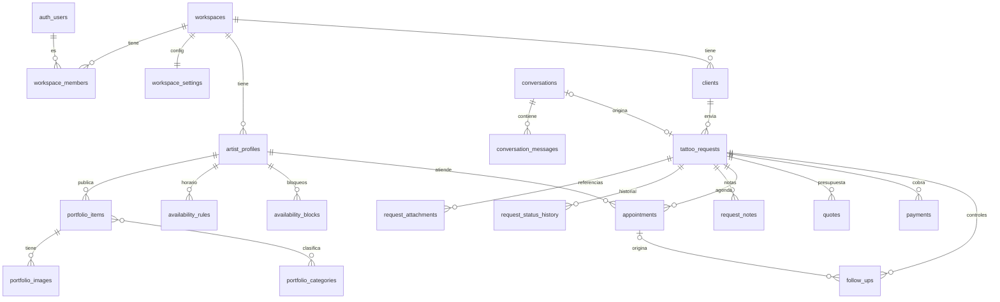

# Base de datos

> Estado: **creadas** `workspaces`, `workspace_members`, `workspace_settings` y `artist_profiles` (Fase 2.1, `supabase/migrations/20261018012835_workspaces_y_perfiles.sql`). El resto del modelo es el diseño acordado en la Fase 0 y se crea en las fases siguientes.
>
> Fase 2.4 (`20261018020342_portfolio.sql`): `portfolio_items` y el bucket `portfolio`.
>
> `supabase/seed.sql` carga el workspace `esti` solo en la base local. Las fotos demo se cargan aparte con `pnpm db:seed-portfolio` (lee `public/demo/*.jpg`, que no se versiona).

## Convenciones

- PK `id uuid default gen_random_uuid()`.
- `created_at` y `updated_at` (`timestamptz`) en todas las tablas.
- Toda tabla privada tiene `workspace_id uuid not null` y RLS activa.
- Estados como `text` + `CHECK` (más fáciles de migrar que `enum`).
- Dinero en `numeric(12,2)` + `currency`, nunca `float`.
- Fechas en `timestamptz` (UTC). Se muestran en la zona del workspace.
- Borrado lógico (`deleted_at`) en entidades de negocio. Borrado físico solo para pedidos de supresión de datos.

## Modelo (v1)



| Tabla | Claves y restricciones principales |
|---|---|
| `workspaces` | `slug` único (URL pública) |
| `workspace_members` | PK (`workspace_id`, `user_id`), `role in ('owner','artist','staff')` |
| `workspace_settings` | 1:1 con workspace; `locale`, `currency`, `timezone` (validada contra `pg_timezone_names`), `location_label`, `instagram_handle`, proceso y FAQ (`jsonb`), `care_instructions` (≤4000, solo owner; se lee con la misma política pública que el resto) |
| `artist_profiles` | `workspace_id`, `user_id` (opcional), `display_name`, `full_name`, `bio`, `styles text[]`, `is_public` |
| `portfolio_items` | `status in ('draft','published')`, `position`, `category` (texto), una foto por trabajo (`image_path`, `image_width`, `image_height`, `alt_text`); `image_path` debe empezar con el `workspace_id`; borrado lógico |
| ~~`portfolio_images`~~ | Postergada: v1 usa una foto por trabajo |
| ~~`portfolio_categories`~~ | Postergada: la categoría es texto en el trabajo y los filtros salen de los publicados |
| `clients` | email o teléfono obligatorio; teléfono solo dígitos; owner o artista editan nombre y contacto; `merge_clients(source, target)` une duplicados en una transacción; únicos parciales (`workspace_id`, `lower(email)`) y (`workspace_id`, `phone`) donde `deleted_at is null`; borrado lógico |
| `conversations` / `conversation_messages` | `token_hash` (sha256 del token de la cookie), `brief` jsonb (validado con zod), `status in ('open','confirmed','closed')`, `message_count` (mensajes de la persona), `input_tokens`/`output_tokens`, `submitter_hash`, `expires_at` (7 días). Los mensajes (`role in ('user','assistant')`, 1-4000) los guarda `record_conversation_turn`, que vuelve a comprobar el tope de mensajes en la base; `workspace_ai_tokens_since` suma el consumo del mes. Ambas solo para la clave secreta. Miembros leen (sin `token_hash` ni `submitter_hash`); anon nada |
| `tattoo_requests` | `status in ('new','reviewing','needs_info','quoted','accepted','rejected','completed','cancelled')`, `source in ('form','assistant','manual')`, `idea`, `body_zone`, `size_label`, `style`, `color_mode in ('black_grey','color')`, `is_cover_up`, `details` (estos cuatro los suma el asistente), `conversation_id` único (la conversación que la generó; un trigger exige que sea del mismo workspace), `submitter_hash` (HMAC de la IP, para el límite de envíos); un trigger exige que el cliente sea del mismo workspace; borrado lógico. `public_token_hash` (sha256 en hex del token del link para el cliente, único) y `public_token_created_at` van juntos; owner o artista los cambian (única otra columna editable además de `status`) |
| `request_attachments` | bucket **privado**, URLs firmadas |
| `request_status_history` | lo escribe un trigger al cambiar `tattoo_requests.status` (`from_status`, `to_status`, `changed_by`); nadie lo inserta ni edita desde la API |
| `request_notes` | notas internas: `author_id` = usuario de la sesión, `body` 1-2000; borrado lógico solo por su autor; un trigger exige que la solicitud sea del mismo workspace; nunca expuestas por rutas públicas |
| `availability_rules` | `weekday` 1-7 (lunes a domingo), `start_time`/`end_time` en hora local del workspace, `slot_minutes` 30-720, `buffer_minutes` 0-240; se reemplaza entero con `set_weekly_availability(artist, rules)`, que rechaza franjas superpuestas |
| `availability_blocks` | `period tstzrange` finito y no vacío, `reason` ≤120; `add_availability_block` convierte fechas y horas locales con la zona del workspace (sin horas = días completos) |
| `appointments` | `period tstzrange` finito, `buffer_minutes` 0-240, `blocked_period` = período + margen (lo calcula un trigger), `status in ('requested','confirmed','cancelled','completed','no_show')`, `source in ('form','manual')`, `request_id` opcional. `EXCLUDE USING gist (artist_id WITH =, blocked_period WITH &&) WHERE (status = 'confirmed')`: Postgres impide dos turnos confirmados superpuestos; los pedidos sí pueden coincidir. Un trigger exige tatuador, cliente y solicitud del mismo workspace. Otro trigger valida los cambios de estado (`requested` → `confirmed`/`cancelled`; `confirmed` → `cancelled`/`completed`/`no_show`, estos dos solo después del inicio; los demás son finales) y que solo se reprogramen turnos abiertos. `merge_clients` también mueve los turnos |
| `quotes` | `amount numeric(12,2) > 0`, `deposit` opcional (≤ `amount`), `currency` ISO de 3 letras (la del estudio al crearlo), `estimated_sessions` 1-20, `valid_until` (fecha), `message` ≤1000, `status in ('draft','sent','accepted','rejected','withdrawn')`, `sent_at`/`responded_at` (los pone un trigger), `created_by` = usuario de la sesión. Índice único parcial: un solo presupuesto abierto (`draft`/`sent`) por solicitud. Un trigger exige solicitud del mismo workspace, valida las transiciones (`draft` → `sent`/`withdrawn`; `sent` → `accepted`/`rejected`/`withdrawn`; el resto es final), impide editar montos y condiciones fuera de borrador y mover el presupuesto o cambiar su moneda. Otro trigger acompaña la solicitud: enviado → `quoted`, aceptado → `accepted`, solo si venía antes en el circuito |
| `payments` | `amount numeric(12,2) > 0`, `currency` (la del estudio), `kind in ('deposit','payment','refund')` (refund resta), `method in ('cash','transfer','card','mercadopago','other')`, `paid_on` (fecha), `note` ≤300, `created_by`, `voided_at`/`voided_by`. Un trigger exige solicitud del mismo workspace y que lo único que cambie sea la anulación, una sola vez, con fecha y usuario puestos por la base. No se borra ni se edita |
| `follow_ups` | controles para el tatuador: `kind in ('healing_check','touch_up','custom')` (custom exige `note`), `due_on` (fecha local), `note` ≤300, `appointment_id` opcional (único por turno y tipo), `done_at`/`done_by` (los pone la base). Al pasar un turno con solicitud a `completed`, un trigger crea los controles de 7 y 30 días con la fecha local del estudio. Un trigger exige solicitud del mismo workspace y que no se cambien solicitud, turno ni tipo |

Postergadas hasta después de la v1: `audit_events`.

## Migraciones

```bash
pnpm exec supabase migration new <nombre>   # crea supabase/migrations/<timestamp>_<nombre>.sql
pnpm db:reset                               # recrea la base local aplicando todas las migraciones + seed
pnpm db:types                               # regenera src/types/database.types.ts
```

Producción se actualiza solo con migraciones versionadas, nunca editando la base a mano.
