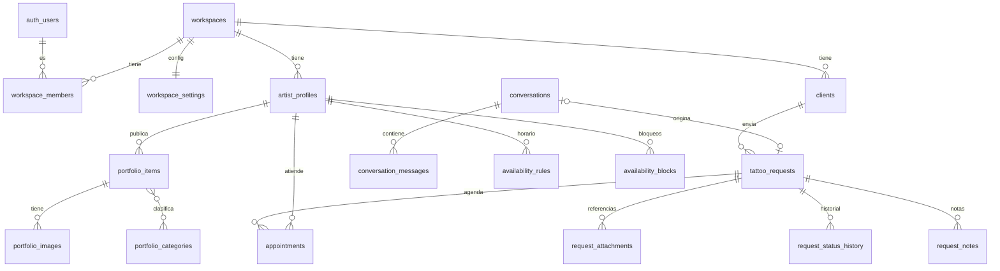

# Base de datos

> Estado: **creadas** `workspaces`, `workspace_members`, `workspace_settings` y `artist_profiles` (Fase 2.1, `supabase/migrations/20261018012835_workspaces_y_perfiles.sql`). El resto del modelo es el diseño acordado en la Fase 0 y se crea en las fases siguientes.
>
> Fase 2.4 (`20261018020342_portfolio.sql`): `portfolio_items` y el bucket `portfolio`.
>
> `supabase/seed.sql` carga el workspace `esti` solo en la base local. Las fotos demo se cargan aparte con `pnpm db:seed-portfolio` (lee `public/demo/*.jpg`, que no se versiona).

## Convenciones

- PK `id uuid default gen_random_uuid()`.
- `created_at` y `updated_at` (`timestamptz`) en todas las tablas.
- Toda tabla privada tiene `workspace_id uuid not null` y RLS activa.
- Estados como `text` + `CHECK` (más fáciles de migrar que `enum`).
- Dinero en `numeric(12,2)` + `currency`, nunca `float`.
- Fechas en `timestamptz` (UTC). Se muestran en la zona del workspace.
- Borrado lógico (`deleted_at`) en entidades de negocio. Borrado físico solo para pedidos de supresión de datos.

## Modelo (v1)



| Tabla | Claves y restricciones principales |
|---|---|
| `workspaces` | `slug` único (URL pública) |
| `workspace_members` | PK (`workspace_id`, `user_id`), `role in ('owner','artist','staff')` |
| `workspace_settings` | 1:1 con workspace; `locale`, `currency`, `timezone` (validada contra `pg_timezone_names`), `location_label`, `instagram_handle`, proceso y FAQ (`jsonb`) |
| `artist_profiles` | `workspace_id`, `user_id` (opcional), `display_name`, `full_name`, `bio`, `styles text[]`, `is_public` |
| `portfolio_items` | `status in ('draft','published')`, `position`, `category` (texto), una foto por trabajo (`image_path`, `image_width`, `image_height`, `alt_text`); `image_path` debe empezar con el `workspace_id`; borrado lógico |
| ~~`portfolio_images`~~ | Postergada: v1 usa una foto por trabajo |
| ~~`portfolio_categories`~~ | Postergada: la categoría es texto en el trabajo y los filtros salen de los publicados |
| `clients` | email o teléfono obligatorio; teléfono solo dígitos; owner o artista editan nombre y contacto; `merge_clients(source, target)` une duplicados en una transacción; únicos parciales (`workspace_id`, `lower(email)`) y (`workspace_id`, `phone`) donde `deleted_at is null`; borrado lógico |
| `conversations` / `conversation_messages` | `public_token_hash`, `expires_at` (retención limitada) |
| `tattoo_requests` | `status in ('new','reviewing','needs_info','quoted','accepted','rejected','completed','cancelled')`, `source in ('form','assistant','manual')`, `idea`, `body_zone`, `size_label`, `submitter_hash` (HMAC de la IP, para el límite de envíos); un trigger exige que el cliente sea del mismo workspace; borrado lógico. `public_token_hash` llega con el seguimiento para clientes |
| `request_attachments` | bucket **privado**, URLs firmadas |
| `request_status_history` | lo escribe un trigger al cambiar `tattoo_requests.status` (`from_status`, `to_status`, `changed_by`); nadie lo inserta ni edita desde la API |
| `request_notes` | notas internas: `author_id` = usuario de la sesión, `body` 1-2000; borrado lógico solo por su autor; un trigger exige que la solicitud sea del mismo workspace; nunca expuestas por rutas públicas |
| `availability_rules` / `availability_blocks` | horario en hora local + zona del workspace; bloqueos como `tstzrange` |
| `appointments` | `EXCLUDE USING gist (artist_id WITH =, blocked_range WITH &&) WHERE (status = 'confirmed')` |

Postergadas hasta después de la v1: `quotes`, `payments`, `care_instructions`, `follow_ups`, `audit_events`.

## Migraciones

```bash
pnpm exec supabase migration new <nombre>   # crea supabase/migrations/<timestamp>_<nombre>.sql
pnpm db:reset                               # recrea la base local aplicando todas las migraciones + seed
pnpm db:types                               # regenera src/types/database.types.ts
```

Producción se actualiza solo con migraciones versionadas, nunca editando la base a mano.
